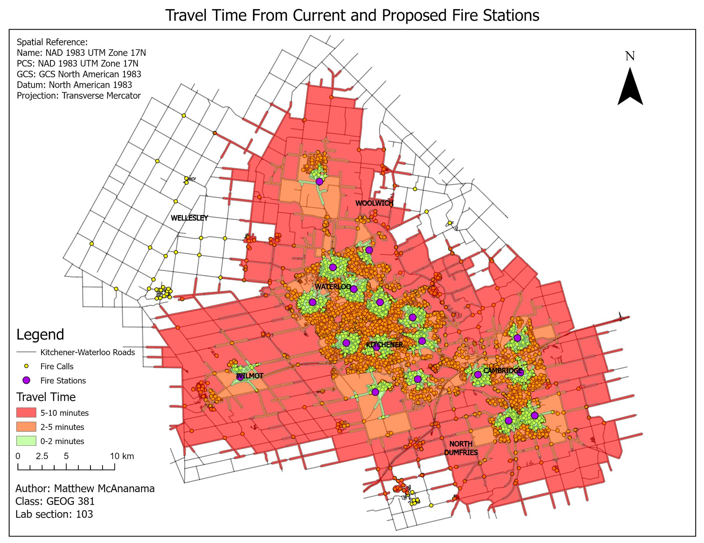
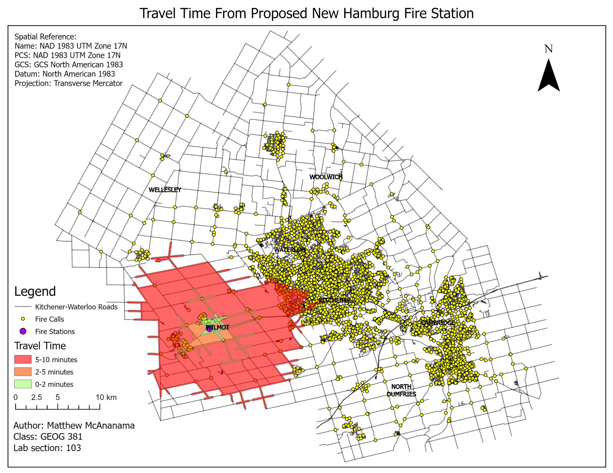
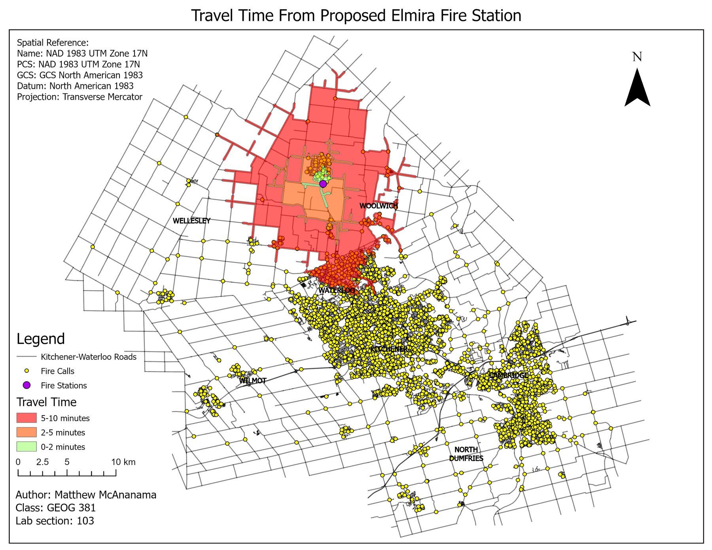
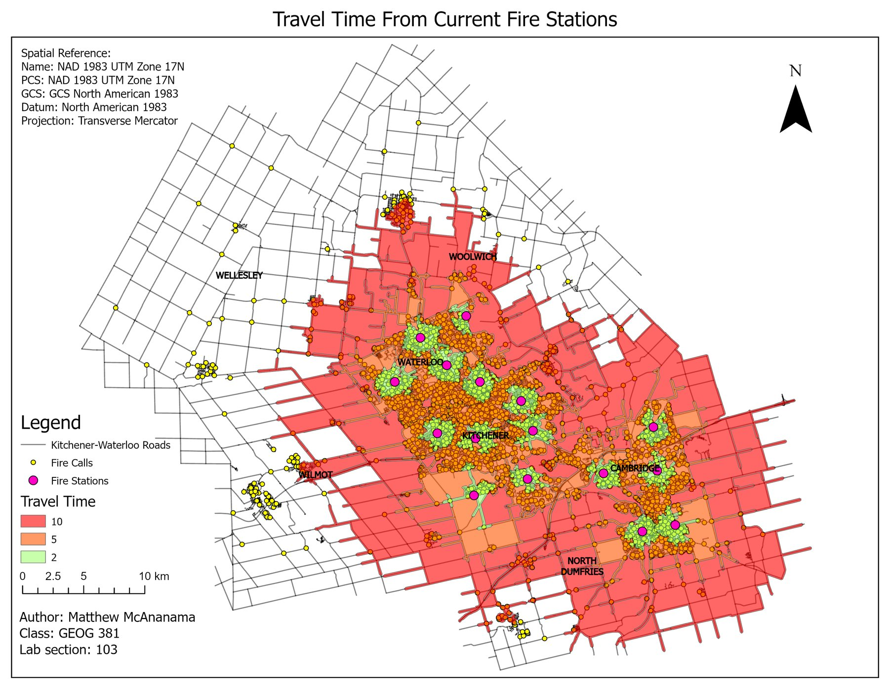

<dl class="facts">
<dt>Question</dt><dd>Which proposed station, New Hamburg or Elmira, improves fire response more?</dd>
<dt>Tools</dt><dd>ArcGIS Pro Network Analyst: network dataset, service areas, location-allocation</dd>
<dt>Data</dt><dd>Road network, current and proposed station locations, and recorded fire calls (provided for the course); municipal boundaries (City of Kitchener open data)</dd>
<dt>Context</dt><dd>Individual coursework, GEOG 381, University of Waterloo, Spring 2025</dd>
</dl>

## The question

In this scenario, the region is weighing two sites for a new fire station: New Hamburg in the west and Elmira in the north. I compared how each one would change response times and workload across the existing 16-station network.

## Approach

- **Travel-time cost.** I added a travel-time field to every road segment (length ÷ posted speed, in minutes) and built a network dataset with that cost and a one-way restriction.
- **Service areas.** I generated 2-, 5- and 10-minute drive-time polygons for the current network, each proposed site on its own, and every combination.
- **Location-allocation.** I assigned every recorded fire call to its nearest station by drive time under four scenarios (current, + New Hamburg, + Elmira, + both), then summarised average response time, calls left outside the 10-minute area, and calls per station.

## Results

| Scenario | Avg. response time | Calls outside 10 min | Calls allocated to new station |
|---|---:|---:|---:|
| Current stations | 3.06 min | 296 | n/a |
| + Elmira | 2.89 min | 162 | 135 |
| + New Hamburg | 2.89 min | 165 | 162 |
| + Both | 2.72 min | 58 | 297 |

: {.result-table}

On average response time and coverage the two sites are nearly tied. Each cuts the average by about 10 seconds and brings roughly 130 more calls inside the 10-minute area. The difference shows up on the map. Most calls near Elmira are already reached within 10 minutes by the existing network, and the region north of Elmira has very few calls. New Hamburg covers a cluster of calls on the western edge that the current network barely reaches, and it takes on 27 more calls than Elmira would.

::: {layout-ncol=2}

:::

**Recommendation:** build at New Hamburg. It relieves more of the network, serves an area the current stations don't reach quickly, and matches Elmira on average response time.

## Limitations

- Travel times use posted speed limits with no turn penalties, traffic or emergency-vehicle behaviour, so absolute times are optimistic. The comparison between sites is more reliable than the minutes themselves.
- The analysis uses one historical set of calls. A full siting study would also look at population growth and where calls are likely to come from in future.
