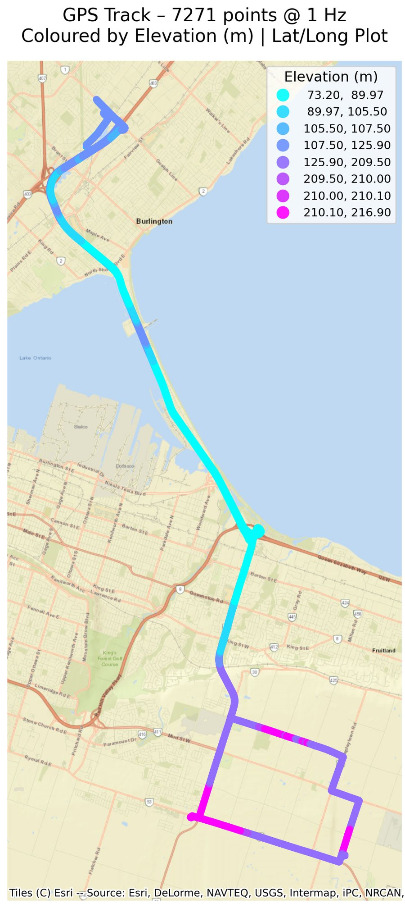
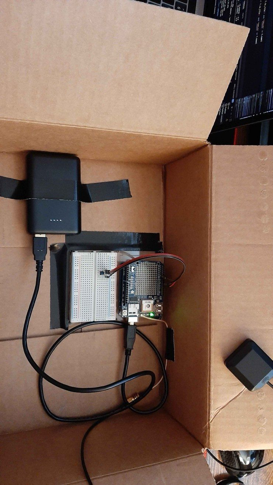
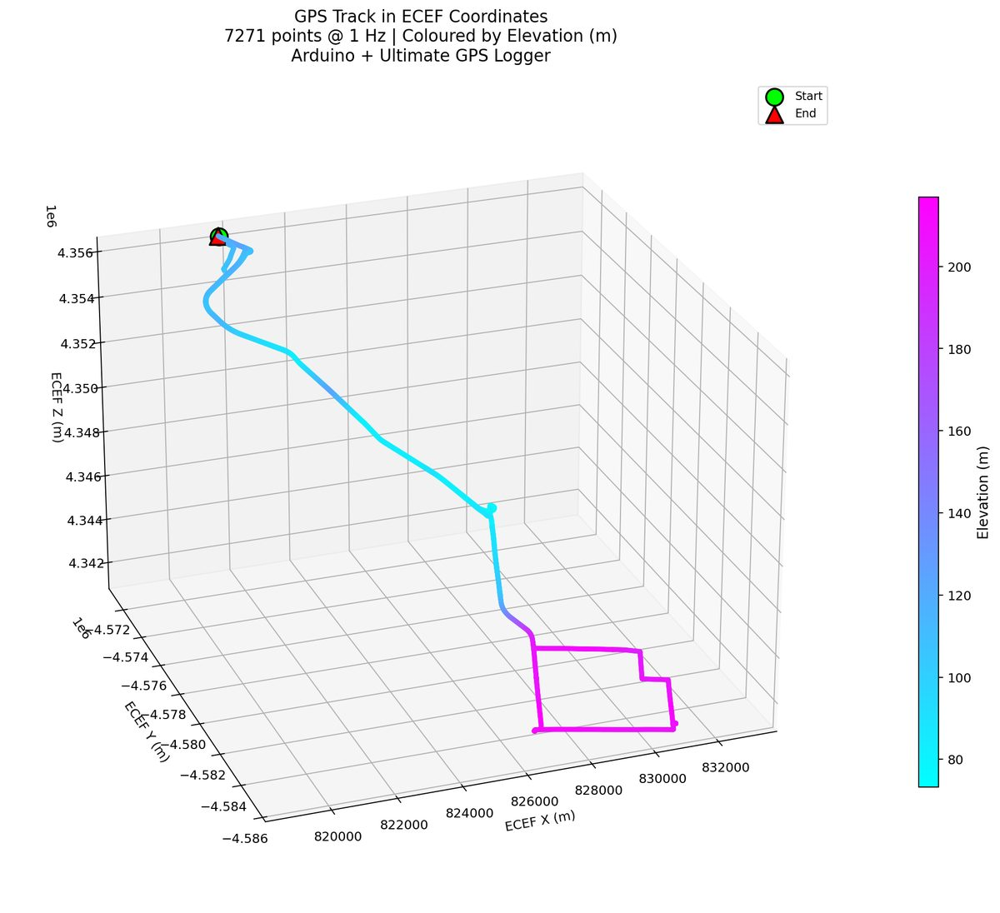
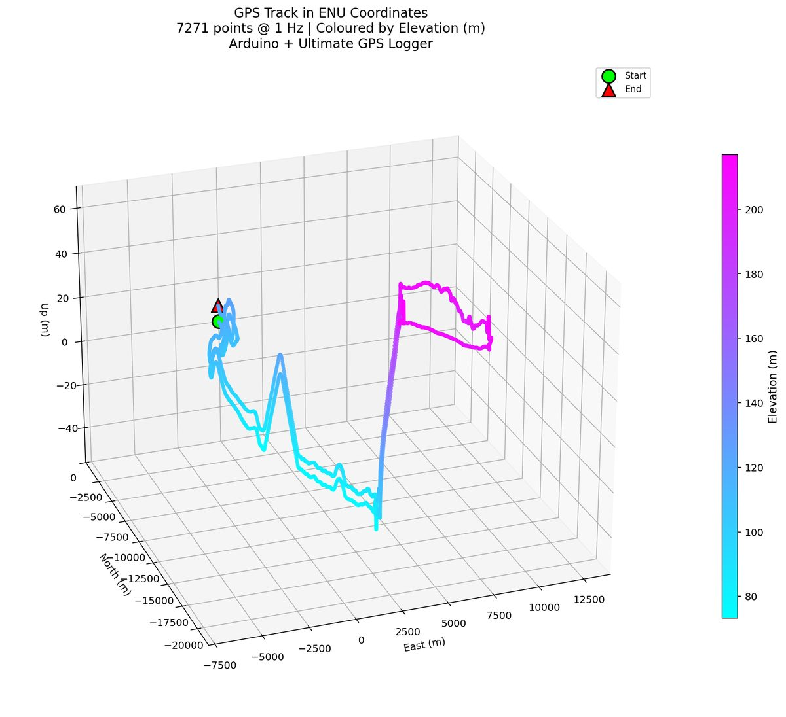

{width=55%}

<dl class="facts">
<dt>Question</dt><dd>Can I build the whole chain myself, from sensor hardware to a positioned, analysed track in a local coordinate frame?</dd>
<dt>Tools</dt><dd>Arduino (C++), Python (Polars, GeoPandas, Matplotlib, contextily), NMEA parsing, WGS84 → ECEF → ENU transformations</dd>
<dt>Hardware</dt><dd>Arduino Uno, Adafruit Ultimate GPS + Logging Shield (MTK3339), external SMA antenna, TMP36 temperature sensor, USB power bank</dd>
<dt>Context</dt><dd>Personal project, data collected March 2026</dd>
</dl>

[View the code on GitHub](https://github.com/sheetmars/gps-data-logger){.btn .btn-outline-primary}

## Why I built it

I wanted to practise the full path from sensor to deliverable: wiring the hardware, writing the firmware, collecting data in the field, then parsing, fusing and transforming it into something useful. The test was a two-hour round-trip drive between Burlington and Hamilton, Ontario.

{width=45%}

## How it works

**Firmware.** The sketch reads NMEA sentences from the GPS on a timer interrupt and writes the RMC and GGA sentences to the SD card once per second. Every 10 seconds, when the GPS has a fix, it reads the TMP36 and writes a timestamped line to a separate log. It is based on Adafruit's `shield_sdlog` example; I added the temperature sensor, the second log file and the fix-gated logging.

**Processing.** A Python script (also available as a notebook):

1. **Parses** the raw `$GPGGA` sentences for UTC time, satellite count, position (converted from degrees and decimal minutes) and altitude, and `$GPRMC` for speed over ground.
2. **Fuses** the 0.1 Hz temperature stream with the 1 Hz position stream by joining on time and linearly interpolating temperature to 1 Hz.
3. **Transforms** WGS84 geodetic coordinates to Earth-Centred Earth-Fixed (X, Y, Z), then rotates them into a local East-North-Up frame with its origin at the first fix.
4. **Plots** the drive in all three frames.

## Results

::: {layout-ncol=2}

:::

The ENU view is the practical one for local work: every position reads as metres east, north and up from a chosen origin, which is how a survey or a robot would use it. ECEF is the necessary intermediate step. The climb onto the Niagara Escarpment on the Hamilton side shows clearly in the vertical axis.

## Notes and limitations

- **Privacy:** the published logs are trimmed to remove everything within 1.5 km of the start and end points.
- **Elevation** comes from single-frequency GPS, so it is noisy, as the spikes in the ENU plot show.
- **Temperature** was logged to practise merging datasets with different sampling rates, and isn't plotted because it varied little over the drive.
- **AI use:** the parsing and plotting code was written with AI assistance. My focus was the hardware build, field data collection and the geodetic → ECEF → ENU workflow.
