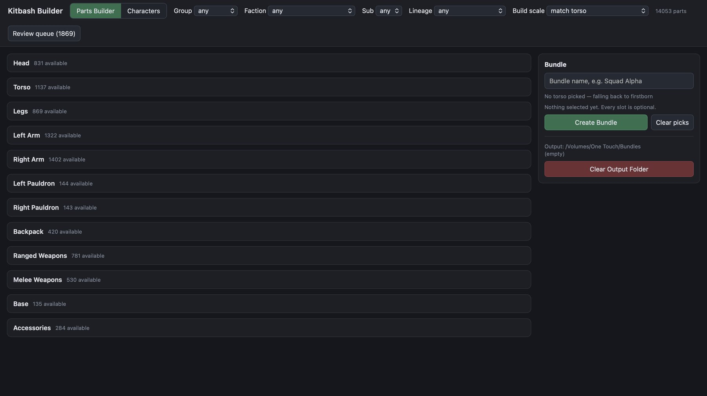

<dl class="facts">
<dt>Problem</dt><dd>Sorting a large collection of downloaded miniature files, and finding parts from different kits that fit together.</dd>
<dt>Tools</dt><dd>Python (NumPy, Pillow, SQLite, openpyxl), a local web server with a WebGL 3D preview, libarchive</dd>
<dt>Context</dt><dd>Hobby project, for 3D printing and painting miniatures</dd>
</dl>

[View the code on GitHub](https://github.com/sheetmars/kitbash-builder){.btn .btn-outline-primary}

## What it does

- **Indexes once.** A single pass reads every STL, measures it, and renders a thumbnail and a lightweight preview mesh into a SQLite database. Reclassifying after that takes seconds and never re-reads the files.
- **Classifies by name and size.** Keyword rules on file and folder names decide each part's slot (head, torso, arm, weapon…), its faction and its armour pattern. Measured size checks the guesses: a 12 mm file can't be a 32 mm figure, whatever it is called.
- **Corrects scale.** Sculptors export in very different units, so each pack gets a scale factor from its confidently identified parts, and parts are rescaled to match the torso you build around.
- **Handles messy downloads.** It recognises supported copies, pre-sliced printer plates, revision folders and images saved with a `.stl` extension, and exports one raw copy of each part.
- **Learns from corrections.** A review workflow writes a spreadsheet per folder; verdicts imported back override the rules on every later run.
- **Extracts archives safely.** A companion script unpacks nested downloads without running anything, blocking path traversal, links, executable bits and archive bombs.

## About the project

I planned and designed this tool for my own hobby of 3D printing and painting miniatures. **AI (Claude) wrote all of the code and the documentation.** No model files are included in the repository; it is meant for organising a collection you already own.
