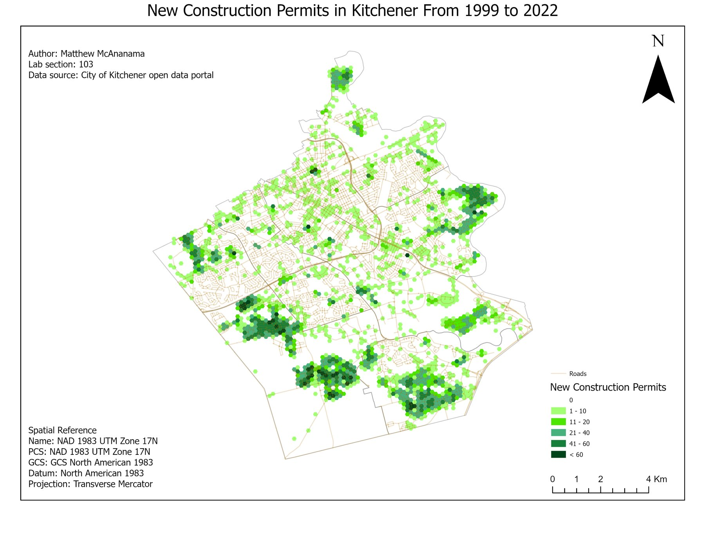
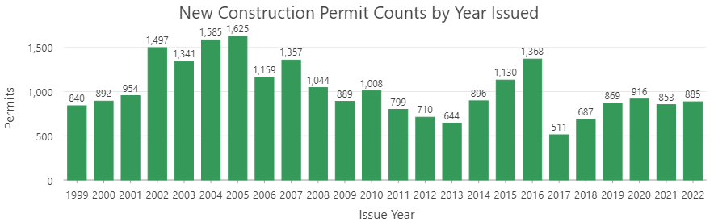

<dl class="facts">
<dt>Question</dt><dd>Where in Kitchener has new construction been concentrated, and how has it changed over time?</dd>
<dt>Tools</dt><dd>ArcGIS Pro (Create Locator, Geocode Addresses, Generate Tessellation, time-enabled layers and animation)</dd>
<dt>Data</dt><dd>Building permit records (CSV, no coordinates); address points, road network and ward boundaries (City of Kitchener open data)</dd>
<dt>Context</dt><dd>Individual coursework, GEOG 381, University of Waterloo, Spring 2025</dd>
</dl>

## Approach

The permit records had street addresses but no coordinates. I built an address locator from the city's address-point layer, geocoded every permit, cleaned the results, and filtered to the "new construction" type. To make the patterns readable, I aggregated permits to a hexagonal grid and enabled time on the layer to animate it year by year.

| Matched | Unmatched | Tied | Match rate |
|---:|---:|---:|---:|
| 69,830 | 2,729 | 1 | 96.2 % |

: {.result-table}

I checked the unmatched addresses (for example, 2396 King St E) and found they point to locations in the middle of a road rather than a building. That's why they're missing from the city's list of valid addresses: the problem is in the permit records, not the locator.

## Results

New construction is concentrated on the edges of the city, in Trussler, Huron Park, Doon South, Williamsburg, Beechwood Forest and Grand River South. Those are the residential areas that grew during this period. A few cells near the core and along major roads pass 60 permits.

```{=html}
<video controls preload="metadata" poster="permit-map.jpg" aria-label="Animation of new construction permits by year, 1999 to 2022">
  <source src="permit-animation.mp4" type="video/mp4">
</video>
```



Two peaks stand out: 2002–2007, during a period of strong residential growth, and 2014–2016, which lines up with ION light rail construction.

## Limitations

- Hexagon counts reflect how many addresses fall in each cell as well as how much building happened, so dense subdivisions score higher partly because they have more addresses. Normalising by address count would separate the two.
- The link between the 2014–2016 peak and ION construction is a correlation I noticed, not something I tested.
