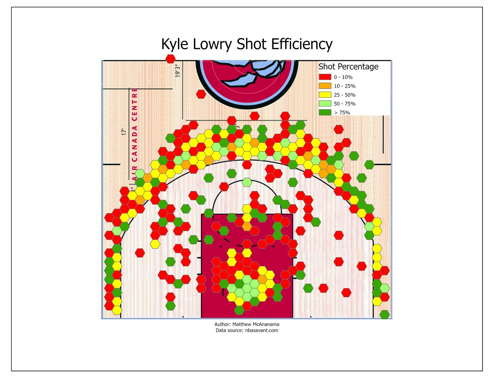
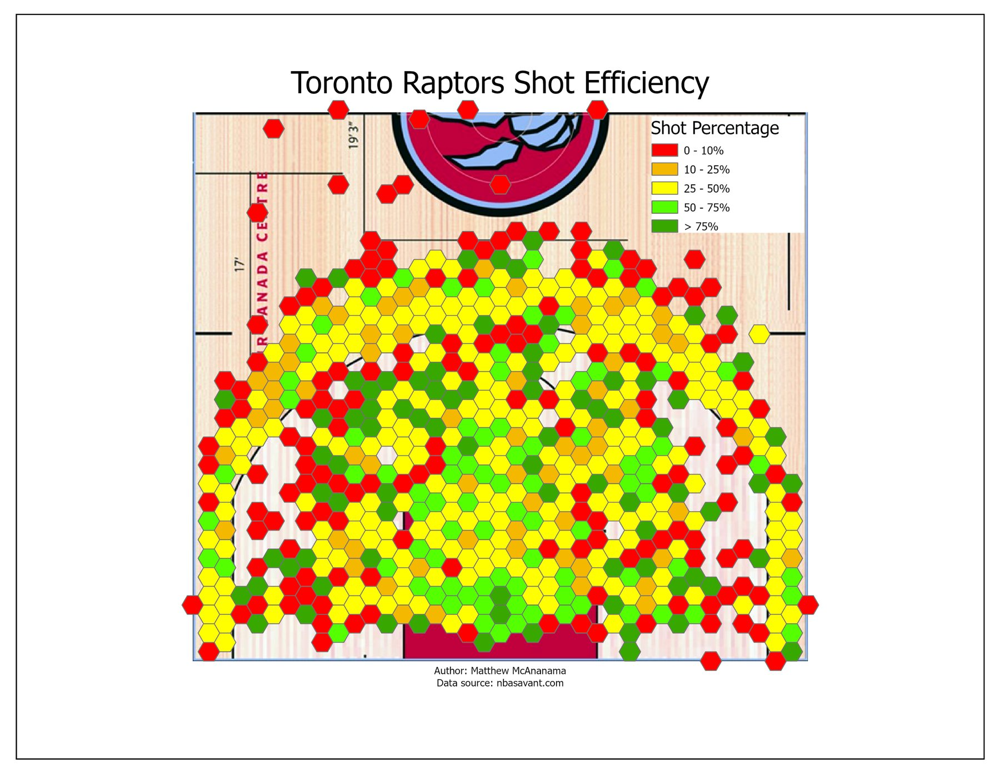
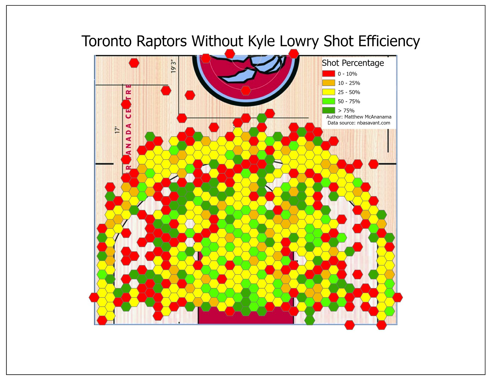
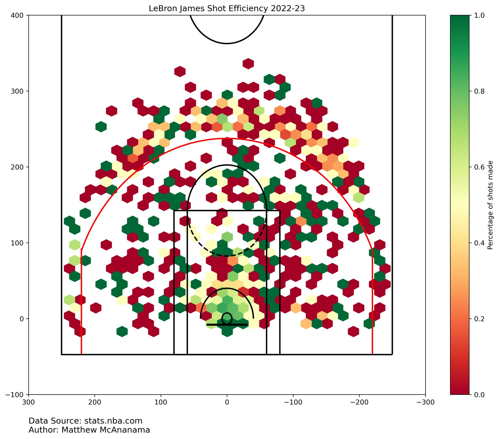
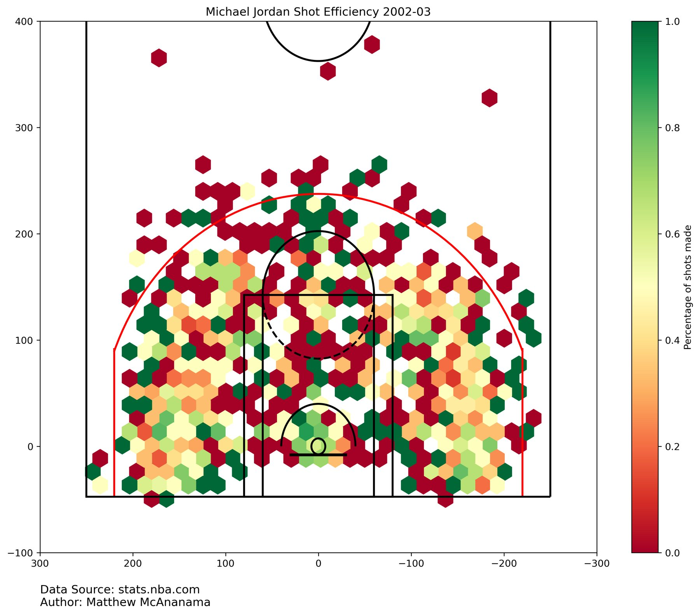

<dl class="facts">
<dt>Question</dt><dd>Where on the court is a player most accurate, and how does that compare with the team or another player?</dd>
<dt>Tools</dt><dd>ArcGIS Pro (XY Table to Point on an image-based reference frame, Generate Tessellation, aggregation to hexagons); the course's Jupyter notebook for pulling NBA API data</dd>
<dt>Data</dt><dd>2017–18 Toronto Raptors shot locations (NBA Savant); LeBron James 2022–23 and Michael Jordan 2002–03 shot logs (NBA API)</dd>
<dt>Context</dt><dd>Individual coursework, GEOG 381, University of Waterloo, Spring 2025</dd>
</dl>

## Approach

Shot locations come in court coordinates, not latitude and longitude. I used a court image as the reference frame, plotted every shot as a point on it, and aggregated the shots into a hexagon grid. For each cell I calculated made ÷ attempted and classed it from 0–10 % up to over 75 %. The same workflow handles filtered subsets, such as one player or the team without that player.

## Results

::: {layout-ncol=2}

:::

Lowry was most accurate around the left, top and top-right of the three-point line, while the team as a whole was strongest just inside the arc. Removing Lowry barely changes the team map because his shots are a small share of the total.

## Comparing LeBron James vs Michael Jordan's last game

::: {layout-ncol=2}

:::

Both are highly accurate at the rim and in pockets of the mid-range. Jordan took far more mid-range shots, while James took more shots at or just behind the three-point line.

## Limitations

- Cells with only a handful of attempts can show 0 % or 100 % by chance. A minimum-attempts threshold, or shading by attempt count, would make the maps more honest.
