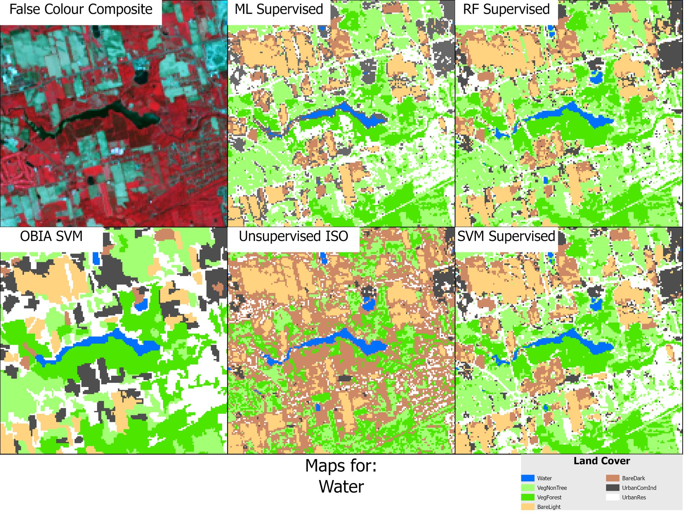
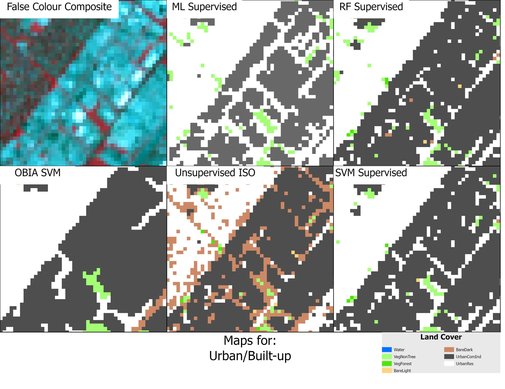
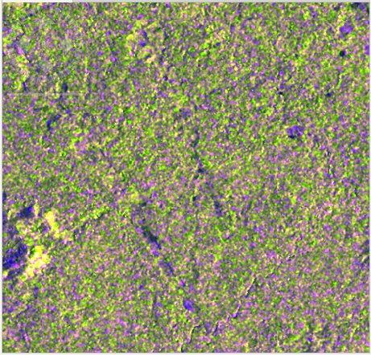
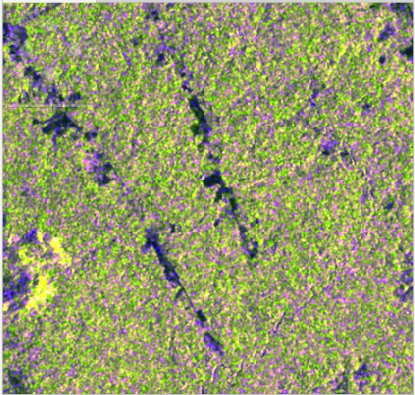
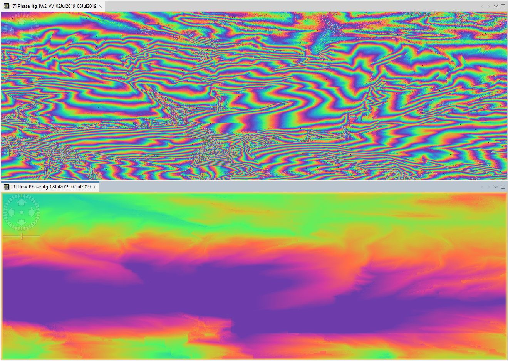
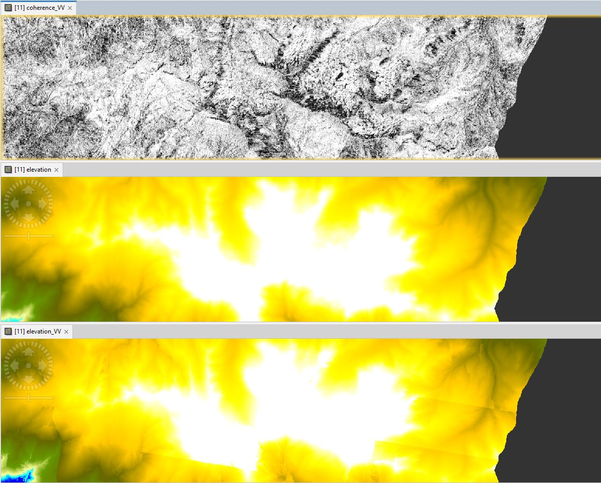
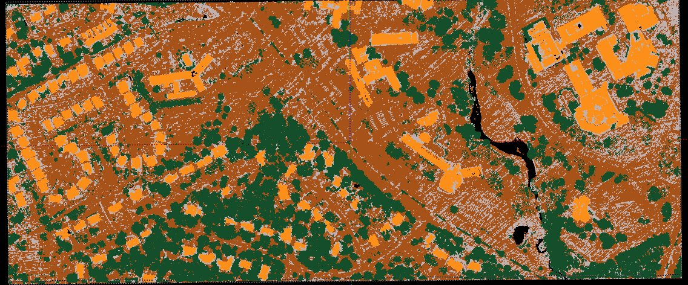
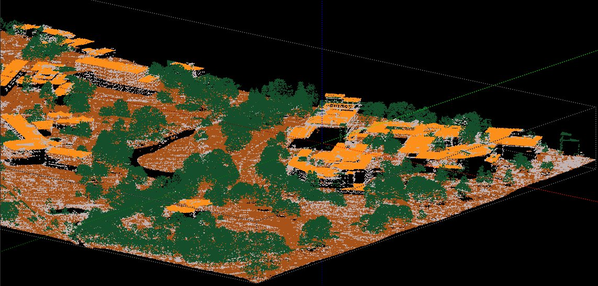
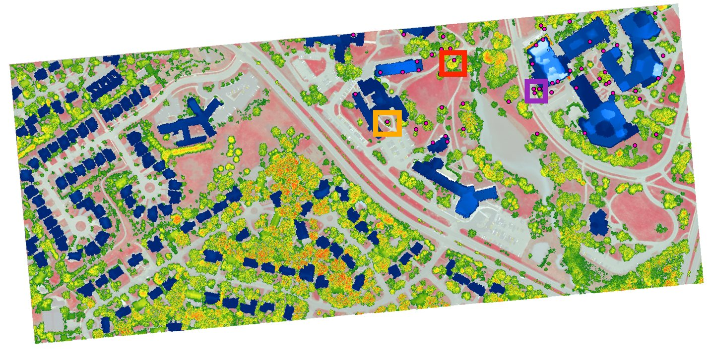

Three lab projects from my remote sensing course, each with a different sensor: a multispectral satellite, a radar satellite and airborne laser scanning.

<dl class="facts">
<dt>Tools</dt><dd>ArcGIS Pro (supervised, unsupervised and object-based classification), ESA SNAP (SAR and InSAR processing), LAStools (point-cloud classification and rasterising)</dd>
<dt>Data</dt><dd>Landsat 8 OLI, Copernicus Sentinel-1, airborne LiDAR with a colour-infrared orthophoto</dd>
<dt>Context</dt><dd>Individual coursework, GEOG 371, University of Waterloo, Winter 2026</dd>
</dl>

## 1. Comparing land-cover classifiers, Hamilton–Burlington

I classified a Landsat 8 scene of Hamilton and Burlington into seven land-cover classes (water, forest, other vegetation, light and dark bare soil, residential, and commercial/industrial). I used five methods, trained on the same samples, and assessed each against 425 check points.

| Method | Overall accuracy | Kappa |
|---|---:|---:|
| Object-based SVM | 90.1 % | 0.88 |
| Random trees (per-pixel) | 89.6 % | 0.88 |
| Support vector machine (per-pixel) | 89.2 % | 0.87 |
| Maximum likelihood (per-pixel) | 82.8 % | 0.80 |
| ISO Cluster (unsupervised) | Very low | n/a |

: {.result-table}

::: {layout-ncol=2}

:::

Water was classified almost perfectly because its spectral signature is so distinct. The main confusion was between forest and other vegetation, and between light and dark soil. The most useful lesson was about **assessment**. The unsupervised result looked reasonable on the map but scored very poorly against the check points, and the object-based result scored best despite looking blocky. Points sample single pixels, so polygon-based or denser check samples would give a fairer accuracy measure.

## 2. Radar: forest change and InSAR elevation

**Forest change.** I compared Sentinel-1 scenes from February 2017 and February 2018 over forest in Roraima, Brazil, using a speckle-filtered RGB composite (R = VH, G = VV, B = VH/VV). VH responds to canopy volume and VV to bare surfaces, so the composite shows canopy as green and gaps as brown. This made the change in cover between the two years easy to see.

::: {layout-ncol=2}

:::

**Elevation from interferometry.** From a Sentinel-1 pair six days apart (perpendicular baseline 174 m), I generated an interferogram, unwrapped the phase, converted it to elevation, and compared the result with the SRTM DEM. Areas of high coherence gave clean fringes, and the InSAR DEM reproduced the main terrain seen in SRTM. Low-coherence areas produced noise, and the unwrapping showed faint tile seams.

::: {layout-ncol=2}

:::

## 3. LiDAR: classifying a point cloud, Laurel Creek, Waterloo

With LAStools, I classified a 1.2-million-return airborne LiDAR tile into ground, high vegetation and buildings. I then built a bare-earth DEM, a surface model and height-above-ground rasters at 0.5 m, using the Laurel Creek outline as a breakline.

::: {layout-ncol=2}

:::

| Class | Points |
|---|---:|
| Ground | 531,705 |
| High vegetation | 418,011 |
| Buildings | 89,906 |
| Unclassified (mostly walls and low objects) | 165,615 |

: {.result-table}

I compared heights from the LiDAR rasters with field-measured heights for three trees and three buildings. Four of the six agreed to within about 1.6 m. One tree was off by 2–3 m and one building by over 4 m, which shows how much a single point measurement depends on where on the feature it's taken. Water returned no points because the scanner's near-infrared pulse is absorbed by water.
