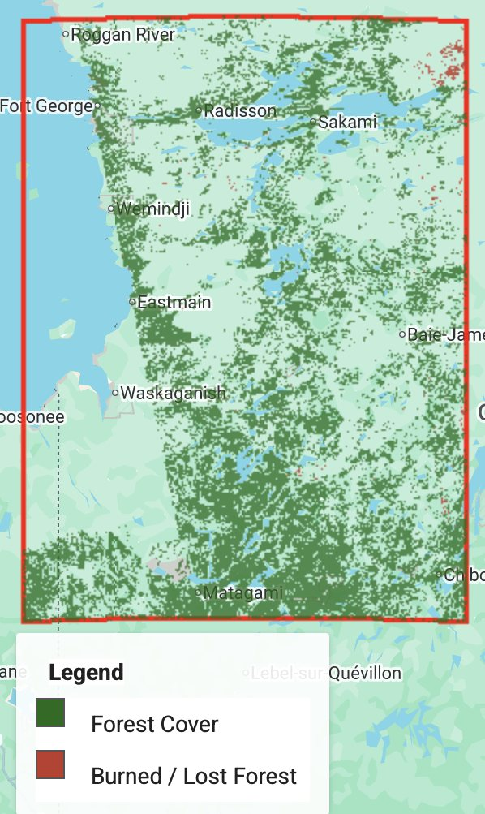
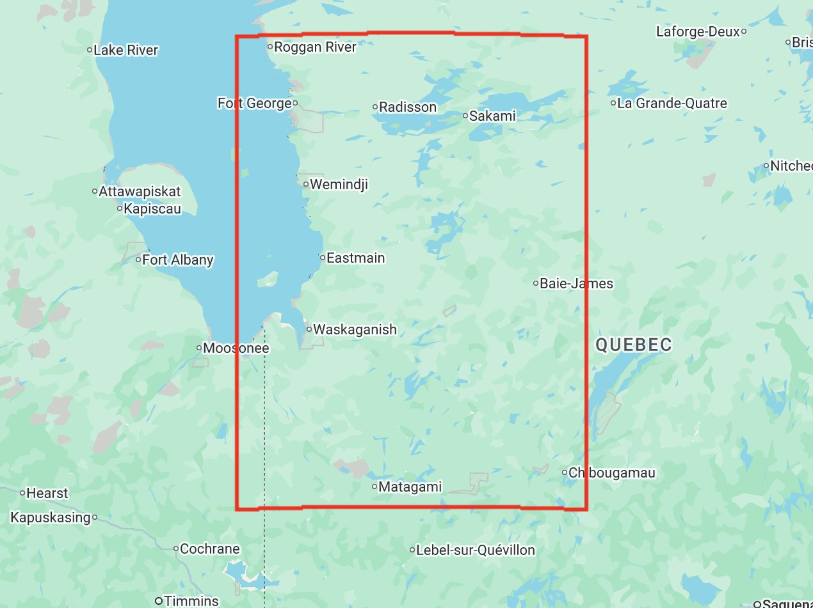
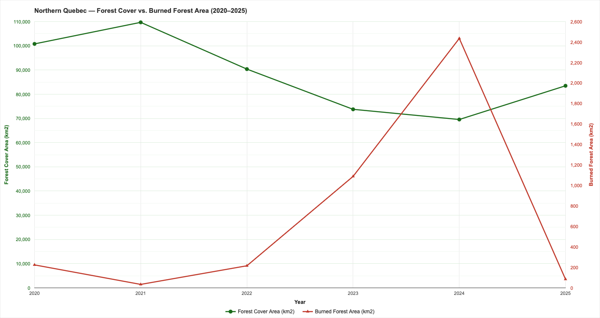

{width=60%}

<dl class="facts">
<dt>Question</dt><dd>How much forest did northwestern Quebec lose to wildfire between 2020 and 2025, and can radar alone detect it?</dd>
<dt>Tools</dt><dd>Google Earth Engine (JavaScript API), Sentinel-1 GRD, threshold classification, change detection</dd>
<dt>Data</dt><dd>Copernicus Sentinel-1 C-band SAR (IW mode, VV + VH), June–September composites for each year</dd>
<dt>Context</dt><dd>Individual coursework, GEOG 371, University of Waterloo, Winter 2026. This was an open-ended project where the brief was to build the analysis with an AI coding assistant, then evaluate the result critically.</dd>
</dl>

## Why radar

The 2023 fire season burned large parts of northern Quebec. Optical imagery struggles with exactly what wildfires produce: smoke and cloud. Sentinel-1 is an active C-band radar, so it sees through both, day or night. I chose the **VH** (cross-polarised) band because it responds to volume scattering in tree canopies, and **VV** because it picks up surface scattering where the canopy is gone. At the AI assistant's suggestion, I also added the **VH/VV ratio** to separate canopy from wetlands, which are common in the region and otherwise look like forest.

## Approach

1. **Composites.** For each year, I built a median composite of all Sentinel-1 scenes from June to September (widened to May–October when coverage was thin), using both orbit directions to avoid gaps.
2. **Forest threshold.** I set the forest threshold from the data itself: the 55th percentile of 2020 VH backscatter. A pixel counts as forest if it is above that threshold *and* its VH/VV ratio is above −8 dB.
3. **Burn detection.** Comparing each year with the one before, I flagged a pixel as burned if its VH backscatter dropped by more than 2 dB.
4. **Area.** I summed the forest and burned pixels using their true geodetic area, at 500 m resolution to stay within Earth Engine's computation limits, and converted to km² for each year.

## Results

The burned-area signal peaks at about 2,400 km² in 2024, with a smaller rise in 2023. Forest cover ranges between about 70,000 and 110,000 km².

## Evaluating the result

The brief asked me to judge the AI-assisted workflow, and the numbers themselves show where it falls short:

- **Forest cover swings more than the landscape can.** Forest area rises by 10,000–15,000 km² in single years (2021 and 2025), which is far faster than planting or regrowth could produce a canopy radar would see. The drop from 2021 to 2024 (about 41,000 km²) is also much larger than the burned area detected (about 3,700 km²). Some of that could be harvesting, which this method doesn't separate from fire, but a threshold set from 2020 data, year-to-year differences in moisture and scene coverage, and gaps in some years' coverage likely account for much of it.
- **Timing.** The largest burn signal appears a year after the 2023 fires. Because each year is compared with the previous summer's composite, fires that happened during or after a summer's imaging window likely only show up in the next year's comparison.
- **Coarse area estimates.** Summing at 500 m keeps the computation within Earth Engine's limits but blurs small burns and forest edges.
- **No validation.** Checking the burned pixels against the national fire perimeter database would turn these results from plausible into measured.

**AI use:** I used ChatGPT first, and then Claude when ChatGPT's scripts kept failing. I set the problem, the data choice and the requirements, worked through the empty-layer and memory-limit problems with follow-up prompts, and evaluated the output. The assistant wrote the Earth Engine code.
