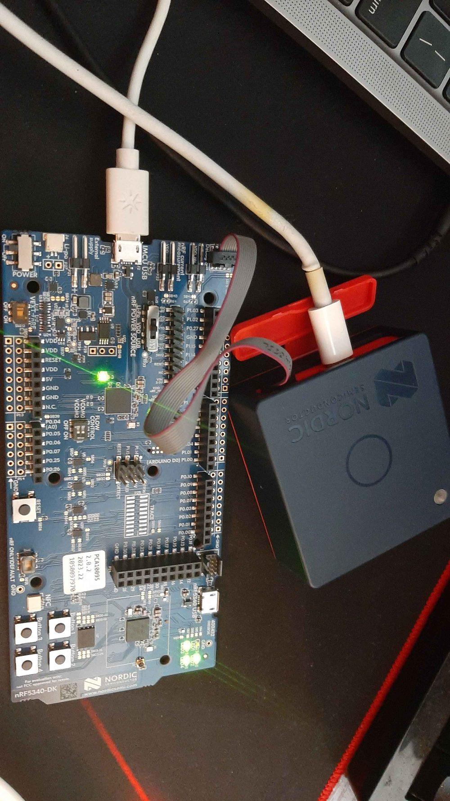

<dl class="facts">
<dt>Question</dt><dd>Can I bring up a board's sensors from their datasheets, and fuse them into a usable orientation estimate?</dd>
<dt>Tools</dt><dd>C, Zephyr RTOS / nRF Connect SDK v2.5.1, devicetree overlays, Kconfig, I2C and SPI, Zephyr sensor API, SEGGER RTT</dd>
<dt>Hardware</dt><dd>Nordic Thingy:53 (nRF5340 with Bosch BME688, BMM150 and BMI270), nRF5340 DK as programmer and debugger</dd>
<dt>Context</dt><dd>Personal project, after completing Nordic Developer Academy's nRF Connect SDK and Bluetooth LE Fundamentals courses</dd>
</dl>

[View the code on GitHub](https://github.com/sheetmars/thingy53-sensors){.btn .btn-outline-primary}

{width=40%}

## Five apps, each building on the last

| # | Sensor | What it does |
|---|---|---|
| 01 | BME688 | Raw I2C temperature read with factory-calibration compensation (first attempt, started from a course exercise) |
| 02 | BME688 | Temperature, pressure and humidity with the full calibration set |
| 03 | BMM150 | 3-axis magnetic field in µT from the chip's trim registers |
| 04 | BMI270 | Accelerometer and gyroscope through Zephyr's sensor API, plus static tilt from gravity |
| 05 | BMI270 + BMM150 | Roll and pitch from the accelerometer, then heading from the magnetometer projected onto the horizontal plane |

## What was involved

- **Register-level drivers.** I read the data and calibration registers straight from the Bosch datasheets, reassembled multi-byte and bit-packed values, and handled signed calibration constants and the sign extension of 13- and 15-bit readings.
- **Order matters.** On the BME688, humidity oversampling has to be written *before* the measurement-control register, because writing that register in forced mode starts a conversion immediately and a later humidity setting is ignored.
- **Compensation.** The manufacturers' formulas (the BME688 temperature, pressure and humidity polynomials, and the BMM150's trim-based X/Y/Z compensation) turn raw ADC counts into physical units. A total field of about 60 µT was a good sanity check against Earth's field.
- **Sensor fusion.** Roll and pitch come from the gravity vector. Heading comes from projecting the magnetic field onto the horizontal plane using roll and pitch, so tilting the board doesn't change the reported heading.

## Results

### Sensor readings (apps 01–04)

Each driver was checked against what the physical quantity should be. Readings are from the RTT console with the board sitting still on a desk indoors.

| App | Reading | Sanity check |
|---|---|---|
| 01 | 22.96 °C | Plausible room temperature, steady to within 0.02 °C between samples |
| 02 | 23.06 °C, 100.42 kPa, 51.9 % RH | Pressure within the normal range for air near the ground; humidity typical indoors |
| 03 | X −19.8, Y 11.4, Z −57.0 µT; total 61.4 µT | Inside Earth's field range of about 25–65 µT. Z dominates, as expected at this latitude, where the field points steeply downward |
| 04 | Accel Z −9.86 m/s²; gyro below 0.01 rad/s | Gravity is 9.81 m/s². The gyro reads near zero at rest; the small offset is bias |

App 01 had calibration bugs: one constant was read from the wrong buffer, and two signed constants were treated as unsigned. I left them as written in 01 and fixed them in 02, so the repo shows the progression.

### Orientation and heading (app 05)

With the board held still, the orientation output behaves as expected: roll reads about ±1.59 rad (±91°) lying on either side, and pitch about ±1.5 rad standing on either end. Turning the board flat through the four compass directions gave these yaw changes:

| Turn (flat, clockwise) | Yaw change |
|---|---:|
| N → E | −1.70 rad |
| E → S | −1.66 rad |
| S → W | −1.38 rad |
| W → N | −1.55 rad |

: {.result-table}

Each quarter-turn should be 1.57 rad, and the four steps add up to a full circle, so yaw tracks rotation correctly. It isn't a compass heading yet, though: it decreases when turning clockwise, and it is measured from the board's X axis rather than from north.

## Limitations and next steps

- **Calibration.** The uneven quarter-turns (1.38–1.70 rad) come from missing hard- and soft-iron calibration; nearby metal and the board's own electronics bias the field.
- **True north.** Heading is magnetic. Correcting it means adding the local declination, about −10° in southern Ontario.
- **Motion.** Accelerometer-only tilt breaks down while the board is moving. The gyroscope is read but not fused yet; a complementary or Madgwick filter is the next step.
- **AI use:** AI was mainly used for debugging: finding register, calibration and sign-handling errors in the drivers. It occasionally helped me interpret register descriptions. The register maps and compensation formulas come from the Bosch datasheets, and the sensor bring-up and the progression to sensor fusion were my own work.
