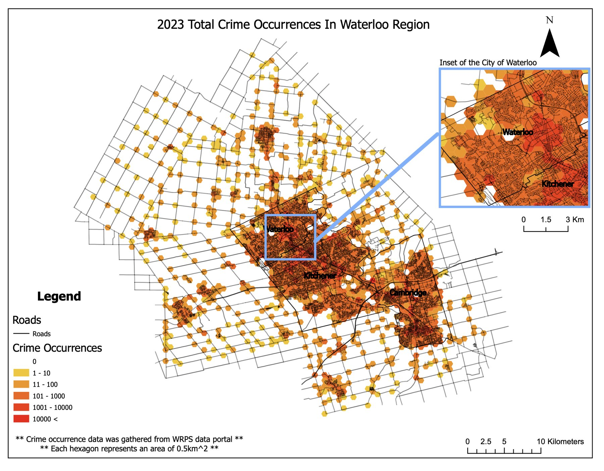
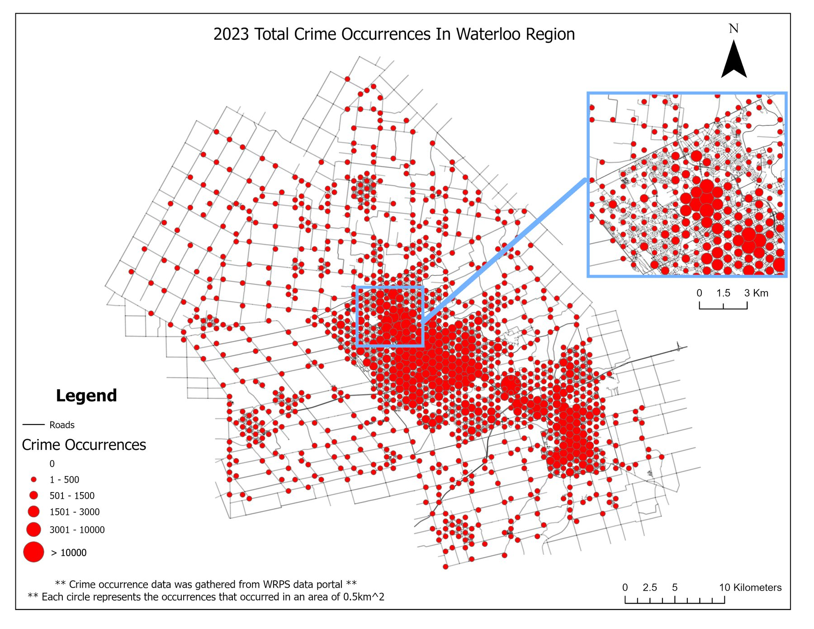
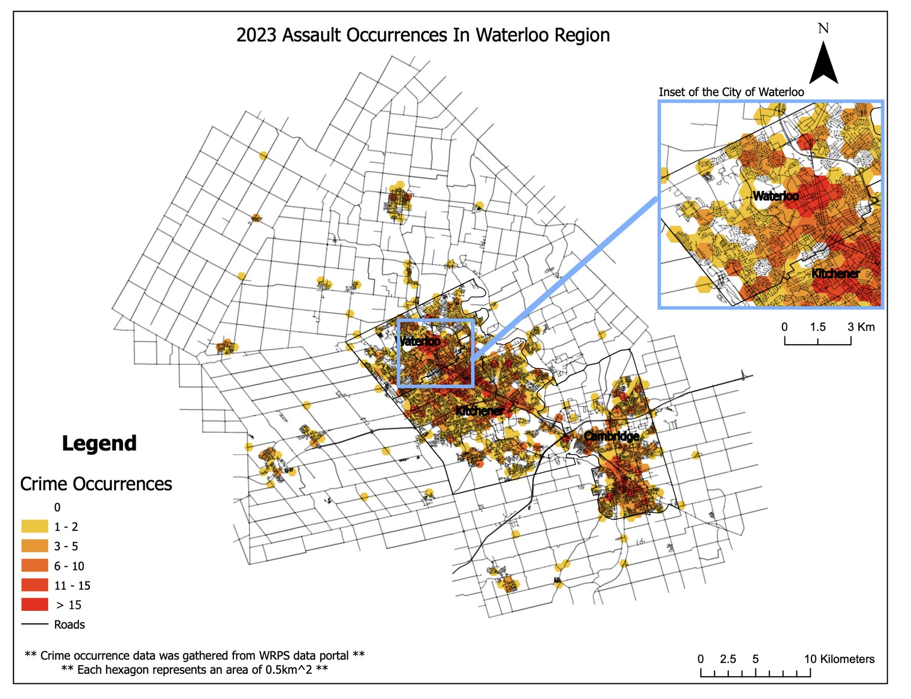
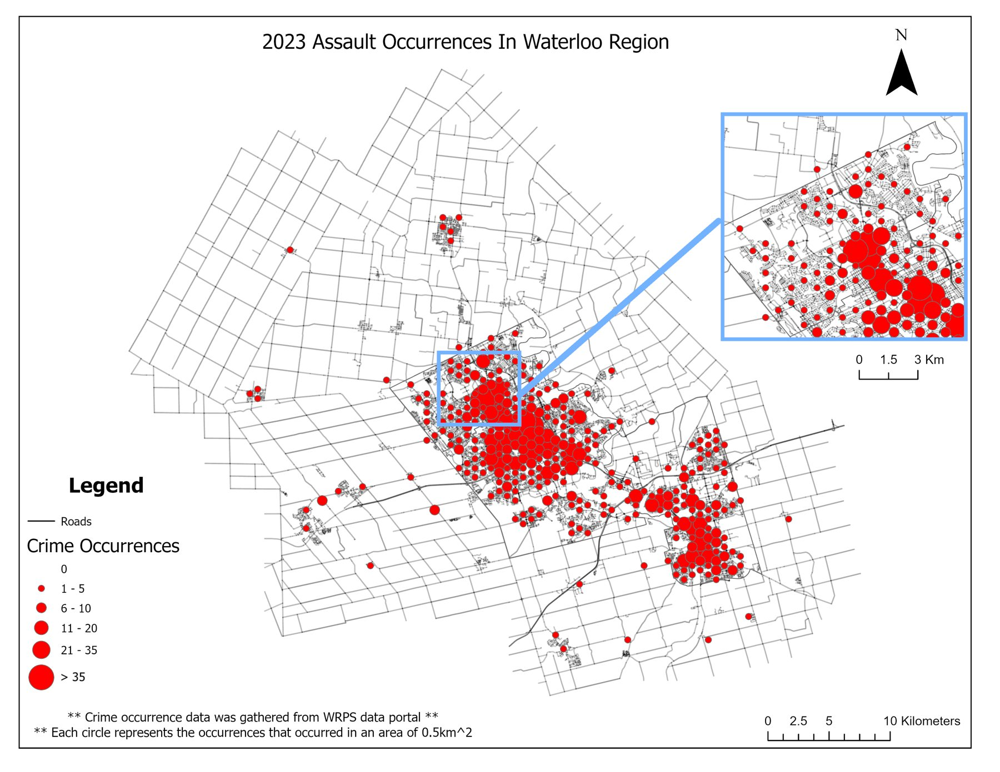

<dl class="facts">
<dt>Question</dt><dd>Where are police occurrences concentrated, and which map type communicates that best for patrol planning?</dd>
<dt>Tools</dt><dd>ArcGIS Pro (XY Table to Point, Generate Tessellation, aggregation to hexagons, choropleth and graduated-symbol symbology), Excel</dd>
<dt>Data</dt><dd>2023 occurrence records (Waterloo Regional Police Service open data portal); municipal boundaries and road network (Region of Waterloo open data)</dd>
<dt>Context</dt><dd>Individual coursework, GEOG 381, University of Waterloo, Spring 2025</dd>
</dl>

## Approach

The occurrence CSV stored each location as one UTM "easting, northing" text field, which ArcGIS Pro can't plot. I split it into separate coordinate columns, converted the records to points, and aggregated them to a 0.5 km² hexagon grid. I mapped total occurrences and individual types (assaults, fires and others) two ways: as a hexagon choropleth and as graduated symbols. Each map includes an inset of the City of Waterloo around the two universities and the college.

## Choropleth vs graduated symbols

::: {layout-ncol=2}

:::

## Results

Occurrences concentrate in the cores of Kitchener, Waterloo and Cambridge, with cells reaching several times the counts of the surrounding townships. Around the post-secondary campuses, activity clusters along University Avenue between Wilfrid Laurier and the east side of the University of Waterloo, the busiest stretch between the institutions.

## Limitations

- These are raw counts. Because the cities hold most of the population, counts largely track where people are. Dividing by population or by daytime activity would show where occurrences are disproportionately high.
- Recorded occurrences depend on reporting, so lower counts in rural areas partly reflect fewer people around to report incidents.
