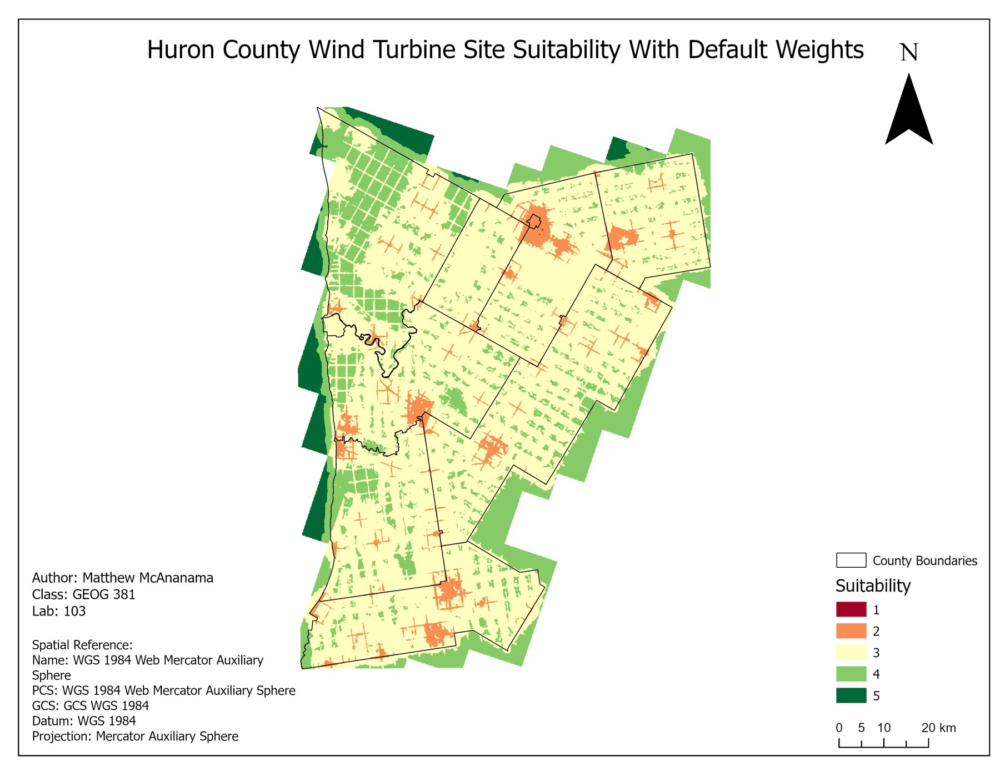
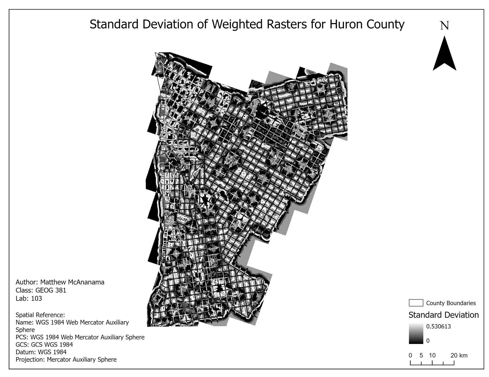
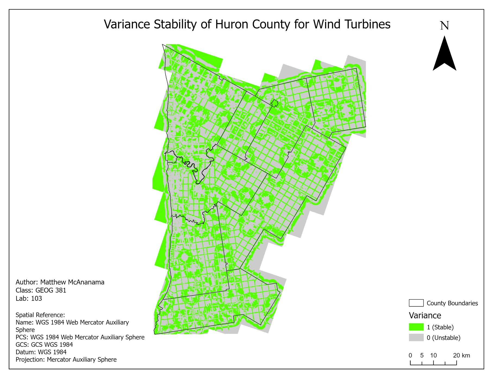
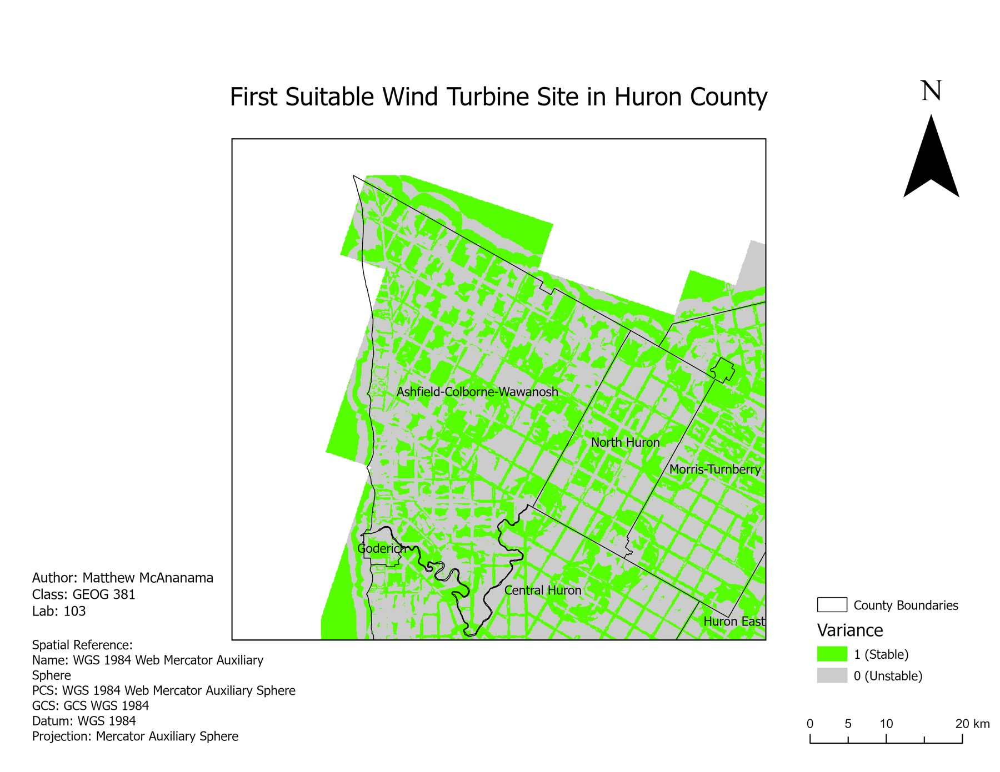
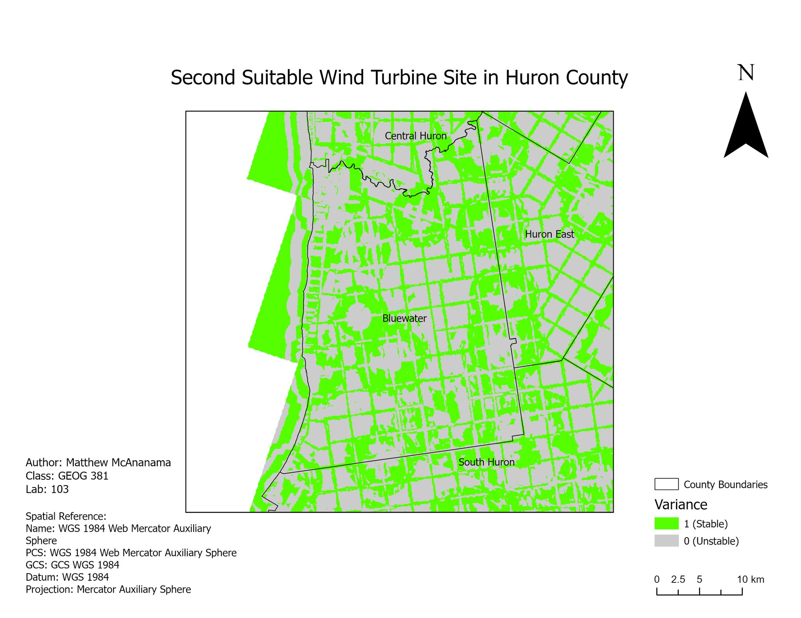

<dl class="facts">
<dt>Question</dt><dd>Where in Huron County should wind turbine farms go?</dd>
<dt>Tools</dt><dd>ArcGIS Pro (multi-ring buffers, rasterisation, reclassification, weighted overlay, cell statistics), QGIS for format conversion</dd>
<dt>Data</dt><dd>CanVec 2019 (buildings, roads, wooded areas) via NRCan's geospatial extraction tool, Canadian Wind Atlas mean wind speed at 30 m, Huron County open data (airports, urban areas, county boundary)</dd>
<dt>Context</dt><dd>Individual coursework, GEOG 381, University of Waterloo, Spring 2025</dd>
</dl>

## Approach

**1. Build the factors.** I clipped every layer to the county. For each constraint I created four buffer rings, starting from a minimum setback (for example, 550 m from buildings) and getting more suitable with distance. I then converted each to a raster on a shared 1–5 suitability scale. The Wind Atlas data had to be converted in QGIS before ArcGIS Pro could read it.

**2. Weight and overlay.** I combined the six factors in a weighted overlay:

| Factor | Weight |
|---|---:|
| Wind speed at 30 m | 30 % |
| Distance from buildings | 20 % |
| Distance from airports | 15 % |
| Distance from urban areas | 15 % |
| Distance from roads | 10 % |
| Distance from wooded areas | 10 % |

: {.result-table}

Wind speed gets the most weight because without wind there's no power. Buildings come next because they block wind and signal people nearby. Roads and woodland come last because they can be built around or cleared.

**3. Test the weights.** The weights are a judgement call, so I tested how much the answer depends on them. I reduced each factor's weight in 10 % steps, from 90 % of its value down to 10 %, and redistributed the difference to the others. That gave 54 alternative suitability rasters. I then took the per-cell standard deviation across all 54 and classed cells with low variation (below 0.25) as stable.

::: {layout-ncol=2}

:::

## Result

A good site has to be both **highly suitable** with the baseline weights (class 4–5) **and stable** across the sensitivity runs. Large stable areas in the centre of the county were ruled out because they're stable at only moderate or low suitability. Two areas pass both tests:

::: {layout-ncol=2}

:::

## Limitations

- The 1–5 scores for each buffer ring are assumptions. A real study would base setbacks on Ontario's renewable energy regulations and add constraints like protected areas and grid connection.
- Wind Atlas data is a modelled long-term average at 30 m, below a modern turbine's hub height.
